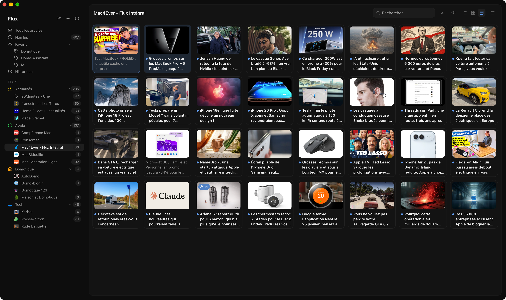
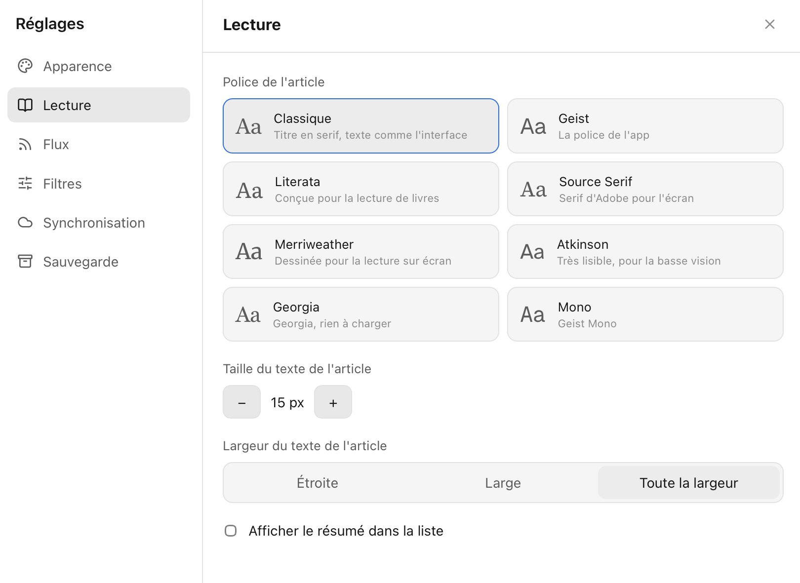
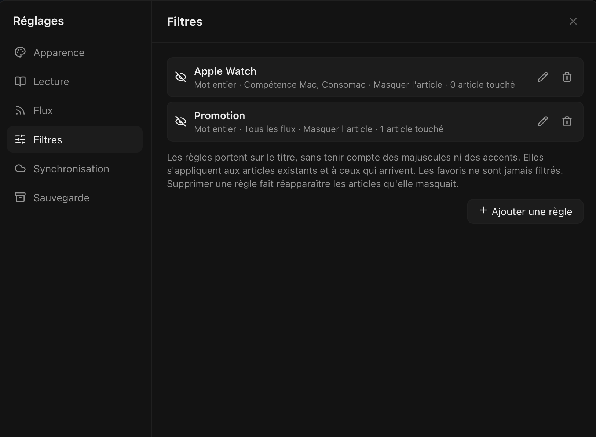
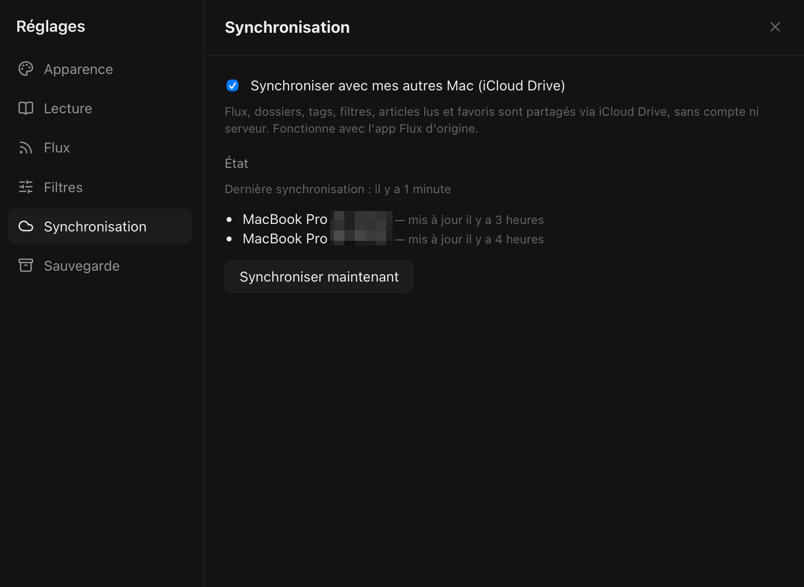
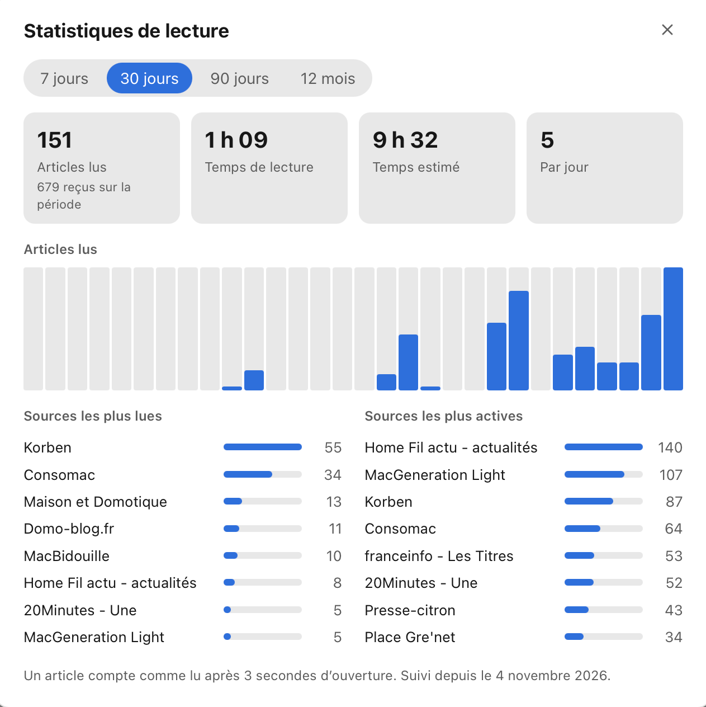

<p align="center">
  
</p>

<h1 align="center">Flux</h1>

<p align="center">
  <a href="https://github.com/Aervorn/MacOS_Flux/releases/latest"></a>
  
  
  <a href="LICENSE"></a>
</p>

<p align="center">
  <a href="README.md">🇬🇧 English</a> · 🇫🇷 Français
</p>

---

Flux est un lecteur RSS simple et soigné pour macOS.

Tu ajoutes tes flux toi-même (pas d'annuaire, pas de compte, pas de recommandations), tu parcours les articles en liste avec miniatures ou en grille, et tu lis **l'article complet directement dans l'app**, sans ouvrir ton navigateur. Tout reste sur ton Mac.

Flux est une app [Tauri](https://tauri.app) (cœur en Rust, interface en React), en français et en anglais, en mode clair et sombre. Les versions jusqu'à la 0.6 étaient des apps SwiftUI natives ; ce code est conservé dans le dossier [`swift/`](swift) et au tag `swift-final`.

> [!NOTE]
> **Développé avec l'aide d'une IA.** Flux est un projet perso que j'ai construit avec [Claude](https://claude.ai), l'assistant d'Anthropic : mes compétences ne m'auraient pas permis de le coder entièrement seul. J'ai défini ce que l'app devait faire, fait les choix d'interface et testé chaque version au quotidien ; Claude a écrit une grande partie du code. Autant jouer cartes sur table.

## 📸 Captures d'écran

<p align="center">
  
</p>

| **Liste avec miniatures** | **Grille pleine largeur** |
|:---:|:---:|
|  |  |
| **Articles similaires regroupés** | **Réglages de lecture** |
|  |  |
| **Règles de filtrage** | **Synchronisation iCloud** |
|  |  |
| **Statistiques de lecture** |  |
|  |  |

## ✨ Fonctionnalités

### 📰 Tes flux, à ta façon

- **Ajoute un flux** en collant son adresse, ou simplement celle du site : Flux trouve le flux déclaré par le site, puis essaie les chemins habituels (`/feed`, `/rss`, `/atom.xml`…).
- **Des dossiers**, repliables, avec leur nombre de non-lus. Clic droit sur un flux pour le renommer, le ranger dans un dossier, ouvrir son site, copier son adresse ou le supprimer ; ou glisse-le sur un dossier. Clic droit sur un dossier pour changer son icône (symbole ou emoji) et sa couleur.
- **Import et export OPML** (menu de l'app) pour reprendre tes abonnements depuis un autre lecteur (NetNewsWire, Reeder, Feedly…) avec leurs dossiers, ou les sauvegarder.
- Le **favicon** du site s'affiche à côté de chaque flux ; la barre latérale et la liste se redimensionnent, et la fenêtre retient sa taille et sa position.
- **Limites :** les dossiers imbriqués d'un fichier OPML sont aplatis dans le dossier le plus proche. Les flux se glissent un par un. Un flux dont la dernière actualisation a échoué reçoit une pastille d'avertissement dans la barre latérale : survole-la (ou clic droit › Voir l’erreur…) pour lire le message et la date de la dernière actualisation réussie ; seule la dernière erreur est conservée, pas un historique.
- **Changer l'adresse d'un flux** (clic droit › Modifier l’adresse…) : saisis la nouvelle adresse du flux ou du site ; les articles, leur état de lecture et les favoris sont conservés, et la synchro transmet le changement à tes autres Mac.

### 🖼️ Une liste agréable à parcourir

- Trois dispositions, à choisir dans la barre d'outils : **liste** (miniature, source, date, titre et résumé facultatif), **grille** (cartes avec le titre, le nombre de colonnes s'adapte à la largeur) et **grille pleine largeur**, où l'article s'ouvre à sa place, avec une flèche de retour.
- Les miniatures viennent du flux (`media:thumbnail`, `enclosure`…), de la première image de l'article ou, en dernier recours, de l'`og:image` de la page.
- **Recherche** dans les articles de la vue en cours, bouton pour **masquer les articles lus**, **tout marquer comme lu**.
- Vues : Tous les articles, Non lus, Favoris, Historique, dossiers, flux et tags.
- **Clavier :** J / K (ou les flèches) pour parcourir la liste, Espace pour faire défiler l'article puis passer au suivant en bas, M pour lu / non lu, S pour favori, B pour ouvrir l'article dans ton navigateur. Aussi ⌘A (tout sélectionner), ⌘N (ajouter un flux), ⌘R (actualiser), ⇧⌘K (tout marquer comme lu), ⌥⌘S (statistiques).
- **Sélection multiple :** ⌘-clic ou ⇧-clic pour sélectionner plusieurs articles, puis clic droit pour les marquer comme lus, les mettre en favoris ou leur ajouter un tag d'un coup.

### 📖 L'article complet, dans l'app

- Quand un flux ne donne qu'un extrait, Flux télécharge la page et en extrait l'article avec [Readability.js](https://github.com/mozilla/readability), le moteur du mode Lecture de Firefox. Un bouton bascule entre la version du flux et l'article complet.
- Mise en page soignée, claire ou sombre, avec une taille de texte réglable (⌘+ ou ⌘= / ⌘− / ⌘0), trois largeurs de texte et un choix de polices d'article. Les liens s'ouvrent dans ton navigateur par défaut.
- **Imprimer ou exporter en PDF** depuis la barre d'outils de l'article : le bouton PDF demande où enregistrer, puis écrit l'article dans un fichier avec la mise en page d'impression (sans barre latérale ni boutons).
- **Limites :** les articles réservés aux abonnés d'un site restent coupés, puisque le site ne fournit pas la suite. Les pages entièrement construites en JavaScript peuvent être mal extraites : le bouton « Ouvrir dans le navigateur » est là pour elles. Les vidéos intégrées de YouTube, Vimeo et Dailymotion affichent un cadre « Lire la vidéo » et ne se chargent qu'au clic (et pas hors ligne) ; les autres lecteurs sont retirés de l'article, seul leur lien reste.

### 🧲 Articles similaires

Quand plusieurs sources publient le même sujet en moins de 48 heures, Flux les regroupe : un seul article apparaît dans les listes, avec un badge « +N », et l'article affiche les autres sources pour lire leur version. Le lire marque tout le groupe comme lu.

- Les articles sont regroupés quand ils pointent vers le même lien, ou que leurs titres partagent assez de mots distinctifs. Quatre niveaux dans le menu de l'app › Réglages : désactivé, faible, normal, élevé.
- Clic droit › Retirer du groupe quand deux sujets différents ont été regroupés.
- Les titres formulés différemment sont aussi comparés **par le sens**, avec les modèles de langue d'Apple calculés sur ton Mac (comme dans la version Swift).
- **Limites :** la comparaison par le sens demande le modèle de la langue du titre sur ton Mac (le français et l'anglais fonctionnent) ; sans lui, seuls les mots et les liens comptent. Le résultat n'est jamais parfait, d'où les niveaux de sensibilité.

### 🚫 Filtres par mots-clés

Des règles (menu › Filtres) agissent sur les articles selon un mot-clé dans leur titre, sans tenir compte de la casse ni des accents : **masquer** l'article, ou simplement le **marquer comme lu**. Une règle s'applique à tous les flux ou seulement à ceux que tu coches, au mot entier ou n'importe où dans le titre, et indique combien d'articles elle concerne.

- Les règles s'appliquent aux articles existants et à venir ; les favoris ne sont jamais filtrés. Supprimer une règle fait réapparaître les articles qu'elle masquait.
- **Limites :** seul le titre est vérifié, pas le texte de l'article ; la règle la plus ancienne l'emporte et l'ordre des règles ne se change pas.

### ⭐ Favoris, tags et historique

- Les **favoris** ne sont jamais supprimés ni marqués comme lus automatiquement.
- **Des tags** pour ranger tes favoris (clic droit sur un article › Tags, ou bouton tag de la barre d'outils de l'article). Les tags sont listés dans la barre latérale.
- L'**historique** liste les articles ouverts, du plus récent au plus ancien.
- **Marquer les articles comme lus** tout de suite, après quelques secondes, ou jamais ; en option, marquer automatiquement les vieux articles comme lus ; supprimer les articles lus après le délai de ton choix (jamais pour les favoris).
- **Archive :** les images d'un favori (miniature et jusqu'à 50 images du texte) sont conservées dans un dossier permanent que ni la limite du cache ni « Vider le cache » ne touchent, et son texte complet est récupéré à l'ajout. Retirer le favori les libère.
- **Limites :** un favori archivé n'a que ce que Flux a pu télécharger à son ajout (une page réservée aux abonnés, ou une image retirée du site depuis, ne se récupère pas).

### 📊 Statistiques de lecture

Menu de l'app › Statistiques de lecture (⌥⌘S) : articles lus, temps passé à lire, temps de lecture estimé (230 mots par minute) et moyenne par jour, sur 7 jours, 30 jours, 90 jours ou 12 mois, avec un graphique des articles lus par jour (par semaine sur 12 mois) et tes sources les plus lues et les plus actives. Un article compte comme lu une fois ouvert pendant 3 secondes.

- **Limites :** le temps passé sur un article est plafonné à 30 minutes par visite. Seul ce que Flux a enregistré est compté : les ouvertures importées de la version Swift sont incluses, mais rien avant.

### 📴 Lecture hors ligne

Réglages › Flux › *Préparer les articles pour la lecture hors ligne* : après chaque actualisation, Flux télécharge le texte complet et les images de tes articles non lus et de tes favoris (400 au plus), pour que tu les lises sans connexion. Le cache d'images reste sous la taille choisie (de 250 Mo à 5 Go, 1 Go par défaut) : les images les moins récemment utilisées partent d'abord, et un bouton vide le cache. Une pastille **Hors ligne** apparaît dans la barre d'outils quand il n'y a pas de connexion, et Flux actualise tout seul à son retour.

- **Limites :** les articles réservés aux abonnés et les pages impossibles à extraire restent tels que le flux les fournit. La préparation télécharge des données après chaque actualisation, mais seulement pour les articles qui n'ont pas encore leur texte complet.

### ☁️ Synchronisation entre Mac

Réglages › Synchronisation : active-la sur chaque Mac (même compte iCloud) pour garder synchronisés tes **flux, dossiers, noms personnalisés, règles de filtrage, articles lus, favoris et leurs tags**. Flux écrit un petit fichier d'état par Mac dans `iCloud Drive/Flux/devices/` et fusionne ceux des autres : quand un élément a changé sur les deux Mac, la modification la plus récente l'emporte, élément par élément. Le format est le même que celui de la version Swift.

- Non synchronisés : réglages, historique et images.
- **Limites :** iCloud Drive doit être activé ; les changements arrivent aussi vite qu'iCloud Drive transporte les fichiers (en général moins d'une minute). La première fois, macOS peut demander l'autorisation d'accéder à iCloud Drive : accepte, Flux réessaie tout seul.

### 💾 Sauvegarde dans iCloud Drive

Réglages › Sauvegarde : une fois par jour, Flux stocke une copie complète de sa base (flux, dossiers, articles, favoris, tags, règles, historique, réglages) dans un `.zip` placé dans `iCloud Drive/Flux/Sauvegardes Tauri/<nom du Mac>/`, en gardant les 3 à 30 dernières. Contrairement à la synchro, supprimer quelque chose ne touche pas aux sauvegardes déjà faites.

- **Restaurer** remplace le contenu actuel au lancement suivant ; le contenu actuel est mis de côté avant.
- **Limite :** les sauvegardes de la version Swift ont un autre format et ne peuvent pas être restaurées ici (utilise plutôt l'import décrit plus bas).

### ⚙️ Réglages

Apparence (automatique, clair, sombre), police de l'interface et densité de la barre latérale, police des articles, taille et largeur du texte, résumé dans la liste, langue, fréquence d'actualisation, délai avant de marquer comme lu, nettoyage automatique, sensibilité des doublons, préparation hors ligne et taille du cache d'images, archive des favoris. Une courte **visite guidée** de Flux s'ouvre au premier lancement (menu de l'app › Découvrir Flux pour la revoir).

## 🧩 Compatibilité

**macOS 14 (Sonoma) ou plus récent**, sur Mac Apple Silicon et Intel.

Formats de flux : **RSS 2.0**, **RSS 1.0 (RDF)**, **Atom** et **JSON Feed**, en `https` ou en `http`.

## 🔐 Autorisations nécessaires

Aucune, sauf une : si tu actives la synchro ou la sauvegarde, macOS demande une fois si Flux peut accéder à iCloud Drive. Sinon, Flux n'utilise le réseau que pour télécharger tes flux, leurs articles et leurs images.

## 🔒 Confidentialité

Flux ne collecte rien et n'envoie rien te concernant. Il n'y a ni compte, ni statistiques d'usage, ni suivi. En dehors de la synchro facultative via ton propre iCloud Drive et de la recherche d'une nouvelle version sur GitHub, les seules requêtes réseau vont directement aux sites auxquels tu es abonné : leurs flux, les pages de leurs articles, leurs images et leurs favicons. Seule exception : une vidéo intégrée, où YouTube, Vimeo ou Dailymotion n'est contacté que si tu cliques sur « Lire ». Tout est stocké sur ton Mac :

- articles, flux, dossiers et réglages : `~/Library/Application Support/io.github.aervorn.flux/flux.sqlite` ;
- miniatures et images : `~/Library/Application Support/io.github.aervorn.flux/images` ; images des favoris archivés : `…/archive` ;
- synchro et sauvegarde (si activées) : `iCloud Drive/Flux/`, stockés dans ton propre iCloud.

## 📥 Installation

1. Télécharge `Flux-x.y.z.dmg` depuis la [dernière version](https://github.com/Aervorn/MacOS_Flux/releases/latest).
2. Ouvre-le et glisse **Flux** sur le dossier **Applications**.
3. Lance Flux depuis ton dossier Applications.

> [!WARNING]
> **Flux n'est pas notarisé par Apple.** Il est signé avec le certificat de son auteur, pas avec un compte Apple Developer payant : macOS le bloque donc à la première ouverture. C'est normal, il suffit de l'autoriser une fois :
>
> 1. Ouvre Flux : macOS indique qu'il ne peut pas le vérifier. Clique sur **Terminé**.
> 2. Ouvre **Réglages Système › Confidentialité et sécurité** et descends jusqu'à la section **Sécurité**.
> 3. À côté du message concernant Flux, clique sur **Ouvrir quand même**, puis confirme avec ton mot de passe.
>
> Sur macOS 14 (Sonoma), tu peux aussi faire Contrôle-clic sur l'app et choisir **Ouvrir**.
>
> Si tu préfères le Terminal : `xattr -dr com.apple.quarantine /Applications/Flux.app`
>
> Tu peux vérifier que le téléchargement est authentique en comparant son empreinte SHA-256 (`shasum -a 256 Flux-x.y.z.dmg`) avec celle indiquée dans les notes de version.

### Tu viens de la version Swift (0.6 et avant) ?

Mettre à jour depuis l'ancienne app installe le nouveau Flux à sa place. Au premier lancement, si Flux retrouve tes anciennes données, il te propose de les **importer** : flux, dossiers, articles, favoris, tags, règles de filtrage et réglages (tes anciennes données sont seulement lues, jamais modifiées). Tu peux aussi lancer l'import plus tard depuis le menu de l'app. L'import n'est proposé que tant que la nouvelle base est vide.

Ton historique et tes temps de lecture sont importés aussi : tes statistiques continuent.

## 🔄 Mettre à jour

Flux recherche une nouvelle version au lancement (ou menu de l'app › **Rechercher les mises à jour…**) et propose de l'installer. Les mises à jour sont signées : Flux refuse tout fichier qui n'a pas été signé par l'auteur.

## 📝 Historique des versions

### 0.8.1
- **Les erreurs de flux dans la barre latérale** : une pastille d'avertissement apparaît à côté d'un flux qui n'a pas pu être actualisé ; survole-la pour lire le message.
- **Icône et couleur d'un dossier** (clic droit sur un dossier) : symboles, emojis et palette de couleurs.
- **Glisse un flux sur un dossier** (ou sur « Flux » pour le sortir), et un dossier fermé s'ouvre quand tu le survoles pendant le glissement.
- **Vidéos intégrées** (YouTube, Vimeo, Dailymotion) lisibles dans l'article, chargées seulement au clic.
- **Export PDF direct** depuis la barre d'outils de l'article, sans passer par la fenêtre d'impression.
- Le **changement d'adresse d'un flux est maintenant transmis par la synchro** : tes autres Mac gardent les articles et leur état.

### 0.8.0
- **Flux est maintenant construit avec Tauri** (cœur en Rust et interface en React) au lieu de SwiftUI : nouveau look avec un thème sombre, trois dispositions (liste, grille, grille pleine largeur) et des panneaux redimensionnables.
- **Tes données suivent** : le premier lancement propose d'importer tout ce que contenait la version Swift (flux, dossiers, articles, favoris, tags, règles de filtrage, réglages).
- Même format de synchronisation iCloud qu'avant, et une nouvelle sauvegarde quotidienne dans iCloud Drive (dossier séparé : les sauvegardes de la version Swift ne se restaurent pas ici).
- Mises à jour automatiques avec l'updater de Tauri, signées avec une nouvelle clé.
- Tout ce que faisait la version Swift est de retour : statistiques de lecture, lecture hors ligne, archive des favoris, raccourcis à une touche (J/K/M/S/B), sélection multiple, changement d'adresse d'un flux et visite guidée du premier lancement. Les articles similaires sont aussi comparés par le sens, comme avant.
- Le code Swift reste disponible dans le dossier `swift/` et au tag `swift-final`.

### Versions Swift

#### 0.6.0
- **Les tags sous chaque favori** : dans Favoris et dans les vues des tags, chaque article affiche ses tags juste en dessous, sur plusieurs lignes si besoin.
- **Nouvelle option : masquer dans Favoris les articles qui ont un tag** (**Réglages › Général**). Les articles tagués n'apparaissent alors plus que dans la vue de leurs tags.
- Fermer la fenêtre principale ferme maintenant aussi la fenêtre des réglages, qui restait ouverte seule (et elle ne se rouvre plus au lancement suivant).

#### 0.5.1
- Nouvelle icône pensée pour macOS 26 : elle s'adapte aux styles d'icônes clair, sombre, transparent et teinté (plus de bordure sombre dans le Dock en mode sombre).

#### 0.5.0
- **Tags pour les favoris** : clic droit sur des articles › Tags, ou le bouton étiquette de la barre d'outils de l'article. Les tags apparaissent sous Favoris dans la barre latérale.
- **Règles de filtrage sur plusieurs flux** : coche les flux concernés par une règle. Raccourci : clic droit sur un flux › Nouvelle règle de filtrage….
- **Sauvegarde dans iCloud Drive** : une copie complète de Flux chaque jour, et la restauration en un clic (**Réglages › iCloud**).
- **Export PDF et impression** d'un article (bouton de la barre d'outils, ⌥⌘E, ⌘P).
- **Changer l'adresse d'un flux** sans perdre ses articles (clic droit › Modifier l'adresse…).
- Une courte découverte de Flux au premier lancement, et une fenêtre « Nouveautés » après les mises à jour (toutes deux dans le menu **Aide**).
- Menus contextuels plus clairs dans la barre latérale, et l'onglet Général des réglages ne demande plus de défiler.

#### 0.4.0
- Mises à jour automatiques avec [Sparkle](https://sparkle-project.org) : Flux recherche les nouvelles versions une fois par jour (**Flux › Rechercher les mises à jour…**, options dans **Réglages › Général**).
- Bouton « Masquer les articles lus » dans la barre d'outils (aussi dans le menu **Présentation**), pour Tous les articles, les dossiers et les flux.
- Les boutons **Ajouter un flux**, **Nouveau dossier** et **Actualiser** sont maintenant dans la barre latérale.

#### 0.3.1
- Nouveau certificat de signature et nouvel identifiant d'app. Tes flux, articles et favoris sont conservés ; les réglages sont réinitialisés.

#### 0.3.0
- Première version téléchargeable (DMG).
- Synchronisation entre Mac par iCloud Drive : flux, dossiers, noms, règles de filtrage, articles lus et favoris.
- Taille du texte des articles réglable (⌘+ ou ⌘= / ⌘− / ⌘0).
- « Récupérer les articles plus anciens » pour les flux qui ne publient que leurs derniers articles (sites WordPress).
- Les favoris sont conservés quand leur flux est supprimé.
- Regroupement des articles similaires plus fiable, fenêtre des réglages adaptée à son contenu.

#### 0.2
- Prise en charge de JSON Feed, vignettes en plein écran, filtres par mots-clés, archive des favoris et Historique, statistiques de lecture, regroupement des articles similaires de plusieurs sources, réglages en onglets.

#### 0.1
- Première version : flux et dossiers ajoutés à la main, vues liste et vignettes, lecture de l'article complet avec Readability, recherche, sélection multiple, raccourcis façon Reeder, lecture hors ligne, import/export OPML, réglages, français et anglais, mode clair et sombre.

## 🛠️ Compiler depuis les sources

Prérequis : macOS 14 ou plus récent, [Rust](https://rustup.rs) (stable), Node.js et [pnpm](https://pnpm.io), et les outils en ligne de commande de Xcode.

```bash
git clone https://github.com/Aervorn/MacOS_Flux.git
cd MacOS_Flux
pnpm install
pnpm tauri dev      # lance l'app en développement
```

`cargo test -p flux-core` lance les tests du cœur Rust, `pnpm check:i18n` vérifie que les deux langues ont les mêmes textes. `pnpm tauri build` compile l'app ; aucun compte développeur Apple ni certificat n'est nécessaire.

```
crates/flux-core/   cœur Rust sans Tauri : base, flux, filtres, articles similaires, synchro, sauvegarde
src-tauri/          coque Tauri : commandes, fenêtre, mises à jour, bundle
src/                interface React (composants, lecteur, textes fr / en)
swift/              l'ancienne app SwiftUI (conservée pour mémoire)
Design/             icône de l'app et fond du DMG
scripts/            make-dmg.sh (release), setup-updater-key.sh, check-i18n.mjs
```

Pour fabriquer un DMG comme ceux publiés, `scripts/make-dmg.sh` compile l'app universelle, vérifie sa signature et crée l'image disque, `latest.json` (mises à jour Tauri) et `appcast.xml` (Sparkle, pour les versions Swift). Il faut [create-dmg](https://github.com/create-dmg/create-dmg), un certificat de signature dont le nom est défini en haut du script, et la clé de mise à jour créée une fois par `scripts/setup-updater-key.sh`.

## 🤝 Contribuer et signaler un problème

Les signalements de bugs, les idées et les pull requests sont les bienvenus !

- **Un flux qui se charge mal ?** [Ouvre une issue](https://github.com/Aervorn/MacOS_Flux/issues/new) avec l'adresse du flux, ta version de macOS, ce que tu attendais et ce qui s'est passé. Une capture d'écran aide beaucoup.
- **Une idée ?** Ouvre d'abord une issue pour en discuter.
- **Une pull request ?** Garde-la centrée sur un seul changement. Les textes de l'interface sont dans `src/locales/fr.json` et `src/locales/en.json` : tout nouveau texte doit exister dans les deux.

## ⚠️ Avertissement

Flux est fourni **« tel quel », sans aucune garantie**. L'auteur ne peut être tenu responsable d'une perte de données ou de tout autre dommage. Tu l'utilises à tes propres risques.

Flux n'est affilié à aucun des sites dont tu lis les flux. Les articles, images et logos appartiennent à leurs auteurs respectifs.

## 📄 Licence

Flux est distribué sous [licence MIT](LICENSE).

Les composants tiers (Readability.js, polices, bibliothèques) et leurs licences sont listés dans [NOTICE.md](NOTICE.md).
