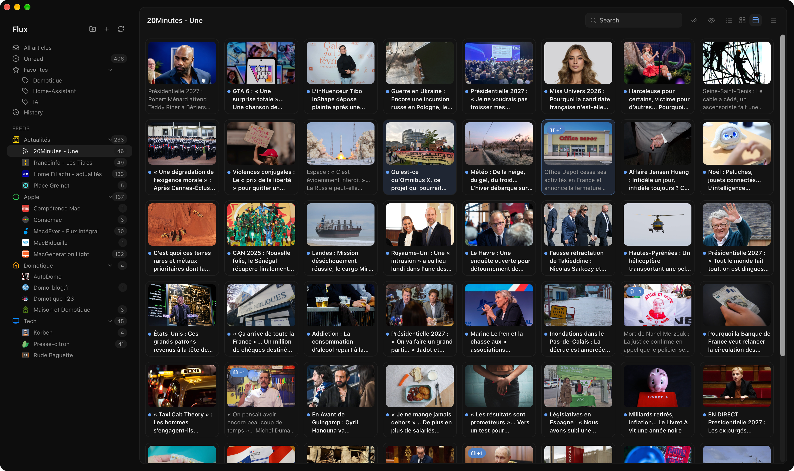
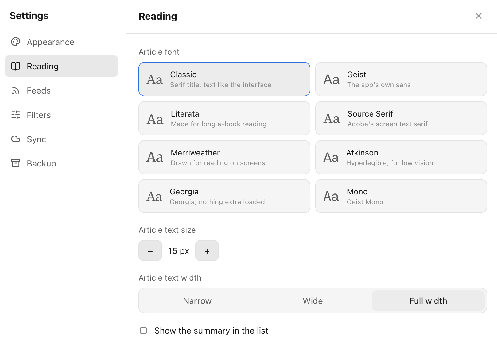
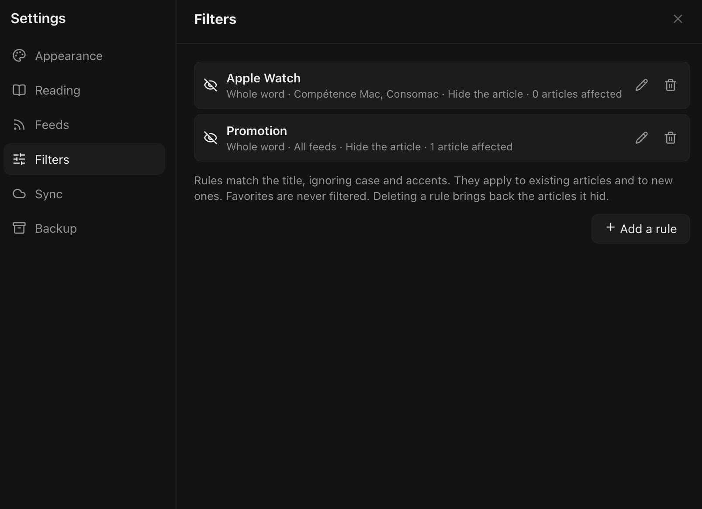
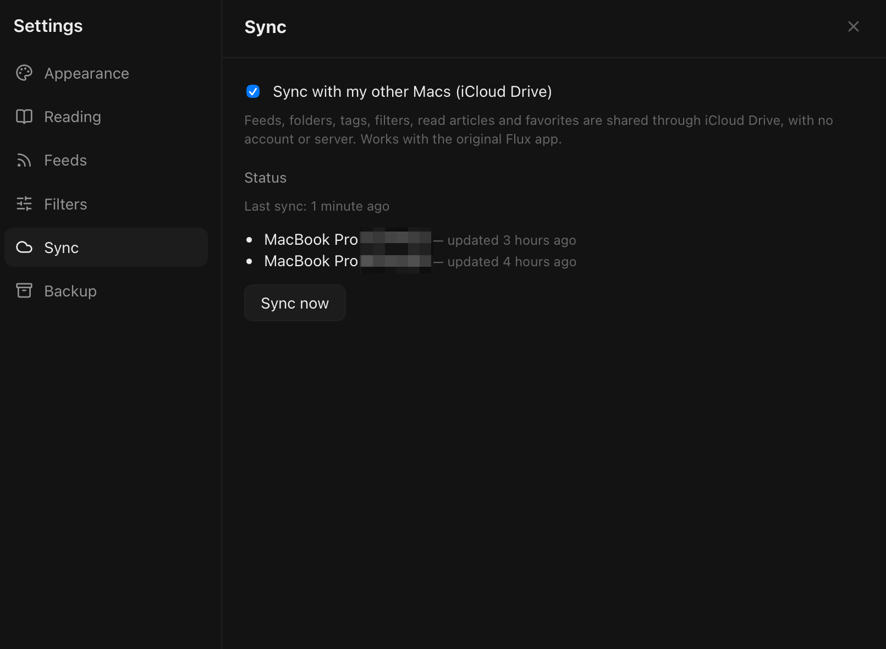
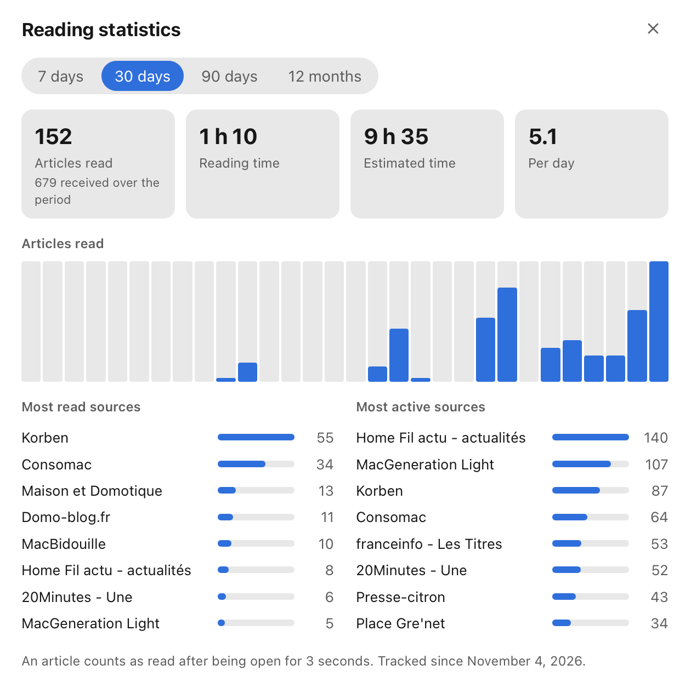

<p align="center">
  
</p>

<h1 align="center">Flux</h1>

<p align="center">
  <a href="https://github.com/Aervorn/MacOS_Flux/releases/latest"></a>
  
  
  <a href="LICENSE"></a>
</p>

<p align="center">
  🇬🇧 English · <a href="README.fr.md">🇫🇷 Français</a>
</p>

---

Flux is a simple, good-looking RSS reader for macOS.

You add your feeds yourself (no directory, no account, no recommendations), you browse the articles as a list with thumbnails or as a grid, and you read the **full article right inside the app**, without opening your browser. Everything stays on your Mac.

Flux is a [Tauri](https://tauri.app) app (Rust core, React interface), available in English and French, in light and dark mode. Versions up to 0.6 were native SwiftUI apps; that code is kept in the [`swift/`](swift) folder and at the `swift-final` tag.

> [!NOTE]
> **Built with the help of AI.** Flux is a personal project I built with [Claude](https://claude.ai), Anthropic's AI assistant: my skills alone wouldn't have been enough to code it entirely by myself. I decided what the app should do, made the design choices and tested every version in daily use; Claude wrote a large part of the code. Just being upfront about it.

## 📸 Screenshots

<p align="center">
  
</p>

| **List with thumbnails** | **Full-width thumbnails** |
|:---:|:---:|
|  |  |
| **Similar articles grouped** | **Reading settings** |
|  |  |
| **Filter rules** | **iCloud sync** |
|  |  |
| **Reading statistics** |  |
|  |  |

## ✨ Features

### 📰 Your feeds, your way

- **Add a feed** by pasting its address, or simply the website's address: Flux finds the feed declared by the site, then tries the usual paths (`/feed`, `/rss`, `/atom.xml`…).
- **Folders**, collapsible, with their own unread count. Right-click a feed to rename it, move it to a folder, open its website, copy its address or delete it; or drag it onto a folder. Right-click a folder to change its icon (symbol or emoji) and color.
- **OPML import and export** (app menu) to bring your subscriptions from another reader (NetNewsWire, Reeder, Feedly…) with their folders, or to back them up.
- The site's **favicon** is shown next to each feed; the sidebar and the list can be resized, and the window remembers its size and position.
- **Limitations:** nested folders in an OPML file are flattened to their closest folder. Feeds are dragged one at a time. A feed whose last refresh failed gets a warning badge in the sidebar: hover it (or right-click › Show error…) for the message and the date of the last successful refresh; it only shows the last error, not a history.
- **Change a feed's address** (right-click › Change address…): enter the new feed or site address; the articles, their read state and the favorites are kept, and the change is carried over by sync to your other Macs.

### 🖼️ A list you enjoy browsing

- Three layouts, switched in the toolbar: **list** (thumbnail, source, date, title and an optional summary), **grid** (cards with the title, the number of columns adapts to the width) and **full-width grid**, where an article opens in place, with a back arrow.
- Thumbnails come from the feed (`media:thumbnail`, `enclosure`…), from the first image of the article, or as a last resort from the page's `og:image`.
- **Search** the articles of the current view, **hide read articles** with one button, **mark all as read**.
- Views: All articles, Unread, Favorites, History, folders, feeds and tags.
- **Keyboard:** J / K (or the arrows) move through the list, Space scrolls the article and moves on to the next one at the bottom, M toggles read, S toggles favorite, B opens the article in your browser. Also ⌘A (select all), ⌘N (add a feed), ⌘R (refresh), ⇧⌘K (mark all as read), ⌥⌘S (statistics).
- **Multiple selection:** ⌘-click or ⇧-click to select several articles, then right-click to mark them as read, favorite them or tag them at once.

### 📖 The full article, in the app

- When a feed only provides an excerpt, Flux downloads the page and extracts the article with [Readability.js](https://github.com/mozilla/readability), the engine behind Firefox's Reader View. A button switches between the feed version and the full article.
- Clean reading layout, light or dark, with an adjustable text size (⌘+ or ⌘= / ⌘− / ⌘0), three text widths and a choice of article fonts. Links open in your default browser.
- **Print or export as PDF** from the article toolbar: the PDF button asks where to save, then writes the article to a file with the print layout (no sidebar, no buttons).
- **Limitations:** articles reserved for a site's subscribers stay cut, since the site itself doesn't serve the rest. Pages built entirely in JavaScript can be extracted poorly: the “Open in browser” button is there for those. Embedded videos from YouTube, Vimeo and Dailymotion show a “Play the video” box and only load when you click it (and not offline); other players are removed from the article, only their link remains.

### 🧲 Similar articles

When several sources publish the same story within 48 hours, Flux groups them: only one article appears in the lists, with a “+N” badge, and the article shows the other sources so you can read their version. Reading it marks the whole group as read.

- Articles are grouped when they point to the same link, or when their titles share enough distinctive words. Four levels in the app menu › Settings: off, low, normal, high.
- Right-click › Remove from group when two different stories got grouped.
- Titles worded differently are also compared **by meaning**, with Apple's on-device language models (as in the Swift version).
- **Limitations:** the meaning comparison needs the language model of the title's language on your Mac (French and English work); without it, only the words and links count. The result is never perfect, hence the sensitivity levels.

### 🚫 Keyword filters

Rules (menu › Filters) act on articles by a keyword in their title, ignoring case and accents: **hide** the article, or simply **mark it as read**. A rule applies to all feeds or only to the ones you check, to the whole word or anywhere in the title, and shows how many articles it affects.

- Rules apply to existing and incoming articles; favorites are never filtered. Deleting a rule brings back the articles it was hiding.
- **Limitations:** only the title is checked, not the article text; the oldest rule wins and rules can't be reordered.

### ⭐ Favorites, tags and history

- **Favorites** are never deleted and never marked as read automatically.
- **Tags** to organize favorites (right-click on an article › Tags, or the tag button in the article toolbar). Tags are listed in the sidebar.
- **History** lists the articles you've opened, most recent first.
- **Mark articles as read** immediately, after a few seconds, or never; optionally mark old articles as read automatically; delete read articles after a delay you choose (never for favorites).
- **Archive:** a favorite's images (thumbnail and up to 50 images of the text) are kept in a permanent folder that neither the cache limit nor “Clear cache” touches, and its full text is fetched when you add it. Removing the favorite releases them.
- **Limitations:** an archived favorite only has what Flux could download when you added it (a page reserved for subscribers, or an image since removed from the site, can't be recovered).

### 📊 Reading statistics

App menu › Reading statistics (⌥⌘S): articles read, time spent reading, estimated reading time (230 words per minute) and average per day, over 7 days, 30 days, 90 days or 12 months, with a chart of the articles read per day (per week over 12 months) and your most read and most active sources. An article counts as read once it has been open for 3 seconds.

- **Limitations:** the time spent on an article is capped at 30 minutes per visit. Only what Flux recorded is counted: the openings imported from the Swift version are included, but nothing before that.

### 📴 Offline reading

Settings › Feeds › *Prepare articles for offline reading*: after each refresh, Flux downloads the full text and the images of your unread articles and favorites (up to 400), so you can read them without a connection. The image cache is kept under the size you choose (250 MB to 5 GB, 1 GB by default): the least recently used images are deleted first, and a button empties the cache. An **Offline** badge appears in the toolbar when there's no connection, and Flux refreshes by itself when it comes back.

- **Limitations:** articles reserved for subscribers and pages that can't be extracted stay as the feed provides them. Preparation downloads data after every refresh, only for the articles that don't have their full text yet.

### ☁️ Sync between Macs

Settings › Sync: turn it on on each Mac (same iCloud account) to keep your **feeds, folders, custom names, filter rules, read articles, favorites and their tags** in sync. Flux writes a small state file per Mac in `iCloud Drive/Flux/devices/` and merges the others: when something changed on both Macs, the most recent change wins, item by item. The format is the same as the Swift version's.

- Not synced: settings, history and images.
- **Limitations:** iCloud Drive must be turned on; changes arrive as fast as iCloud Drive carries the files (usually within a minute). The first time, macOS may ask permission to access iCloud Drive: allow it, Flux retries by itself.

### 💾 Backup to iCloud Drive

Settings › Backup: once a day, Flux stores a complete copy of its database (feeds, folders, articles, favorites, tags, rules, history, settings) as a `.zip` in `iCloud Drive/Flux/Sauvegardes Tauri/<Mac name>/`, keeping the last 3 to 30. Unlike sync, deleting something doesn't touch backups already made.

- **Restore** replaces the current contents at the next launch; the current contents are set aside first.
- **Limitation:** backups made by the Swift version use another format and can't be restored here (use the import described below instead).

### ⚙️ Settings

Appearance (automatic, light, dark), interface font and sidebar density, article font, text size and width, summary in the list, language, refresh interval, mark-as-read delay, automatic cleanup, duplicate sensitivity, offline preparation and image cache size, favorites archive. A short **tour** of Flux opens on first launch (app menu › Discover Flux to see it again).

## 🧩 Compatibility

**macOS 14 (Sonoma) or later**, on Apple Silicon and Intel Macs.

Feed formats: **RSS 2.0**, **RSS 1.0 (RDF)**, **Atom** and **JSON Feed**, served over `https` or `http`.

## 🔐 Required permissions

None, except one: if you turn on sync or backup, macOS asks once whether Flux may access iCloud Drive. Otherwise Flux only uses the network to download your feeds, their articles and their images.

## 🔒 Privacy

Flux collects nothing and sends nothing about you. There is no account, no analytics and no tracking. Apart from the optional sync through your own iCloud Drive and the check for a new version on GitHub, the only network requests go directly to the sites you subscribe to: their feeds, the pages of their articles, their images and their favicons. The one exception is an embedded video: YouTube, Vimeo or Dailymotion is only contacted if you click “Play”. Everything is stored on your Mac:

- articles, feeds, folders and settings: `~/Library/Application Support/io.github.aervorn.flux/flux.sqlite`;
- thumbnails and images: `~/Library/Application Support/io.github.aervorn.flux/images`; archived favorites' images: `…/archive`;
- sync and backup (if turned on): `iCloud Drive/Flux/`, stored in your own iCloud.

## 📥 Installation

1. Download `Flux-x.y.z.dmg` from the [latest release](https://github.com/Aervorn/MacOS_Flux/releases/latest).
2. Open it and drag **Flux** onto the **Applications** folder.
3. Launch Flux from your Applications folder.

> [!WARNING]
> **Flux isn't notarized by Apple.** It's signed with the author's own certificate, not with a paid Apple Developer account, so macOS blocks it the first time it's opened. This is expected; you only need to allow it once:
>
> 1. Open Flux: macOS says it can't verify it. Click **Done**.
> 2. Open **System Settings › Privacy & Security** and scroll down to the **Security** section.
> 3. Next to the message about Flux, click **Open Anyway**, then confirm with your password.
>
> On macOS 14 (Sonoma) you can instead Control-click the app and choose **Open**.
>
> If you prefer the Terminal: `xattr -dr com.apple.quarantine /Applications/Flux.app`
>
> You can check that the download is genuine by comparing its SHA-256 checksum (`shasum -a 256 Flux-x.y.z.dmg`) with the one given in the release notes.

### Coming from the Swift version (0.6 and earlier)

Updating from inside the old app installs the new Flux in its place. On first launch, if Flux finds your old data, it offers to **import** your feeds, folders, articles, favorites, tags, filter rules and settings (your old data is only read, never changed). You can also start the import later from the app menu. The import is only offered while the new database is empty.

Your reading history and reading times are imported too, so your statistics carry on.

## 🔄 Updating

Flux checks for a new version at launch (or app menu › **Check for updates…**) and offers to install it. Updates are signed, and Flux refuses any file that wasn't signed by the author.

## 📝 Changelog

### 0.9.0
- **Feed errors in the sidebar**: a warning badge appears next to a feed that couldn't be refreshed; hover it for the message.
- **Folder icon and color** (right-click a folder): symbols, emojis and a color palette.
- **Drag a feed onto a folder** (or onto “Feeds” to take it out), and a closed folder opens when you hover it while dragging.
- **Embedded videos** (YouTube, Vimeo, Dailymotion) can be played in the article, loaded only when you click.
- **Direct PDF export** from the article toolbar, without going through the print dialog.
- A feed's **address change is now carried over by sync**: your other Macs keep the articles and their state.

### 0.8.0
- **Flux is now built with Tauri** (Rust core and React interface) instead of SwiftUI: a new look, with a dark theme, three layouts (list, grid, full-width grid) and resizable panels.
- **Your data comes with you**: the first launch offers to import everything from the Swift version (feeds, folders, articles, favorites, tags, filter rules, settings).
- Same iCloud sync format as before, and a new daily backup to iCloud Drive (separate folder: backups from the Swift version can't be restored here).
- Automatic updates with the Tauri updater, signed with a new key.
- Everything from the Swift version is back: reading statistics, offline reading, favorites archive, single-key shortcuts (J/K/M/S/B), multiple selection, changing a feed's address and the first-launch tour. Similar articles are compared by meaning again too.
- The Swift source stays available in the `swift/` folder and at the `swift-final` tag.

### Swift versions

#### 0.6.0
- **Tags under each favorite**: in Favorites and in tag views, each article shows its tags right below it, on several lines if needed.
- **New option: hide tagged articles from Favorites** (**Settings › General**). Tagged articles then only appear in the view of their tags.
- Closing the main window now also closes the Settings window, which used to stay open on its own (and it no longer reopens at the next launch).

#### 0.5.1
- New app icon made for macOS 26: it adapts to the light, dark, clear and tinted icon styles (no more dark border in the Dock in dark mode).

#### 0.5.0
- **Tags for favorites**: right-click on articles › Tags, or the tag button in the article toolbar. Tags appear under Favorites in the sidebar.
- **Filter rules on several feeds**: check the feeds a rule applies to. Shortcut: right-click a feed › New Filter Rule….
- **Backup to iCloud Drive**: a complete daily copy of Flux, with one-click restore (**Settings › iCloud**).
- **Export as PDF and print** an article (toolbar button, ⌥⌘E, ⌘P).
- **Change a feed's address** without losing its articles (right-click › Change Address…).
- A short tour of Flux on first launch, and a "What's New" window after updates (both in the **Help** menu).
- Clearer context menus in the sidebar, and the General settings tab no longer needs scrolling.

#### 0.4.0
- Automatic updates with [Sparkle](https://sparkle-project.org): Flux checks for new versions once a day (**Flux › Check for Updates…**, options in **Settings › General**).
- "Hide read articles" button in the toolbar (also in the **View** menu), for All Articles, folders and feeds.
- The **Add Feed**, **New Folder** and **Refresh** buttons are now in the sidebar.

#### 0.3.1
- New signing certificate and bundle identifier. Your feeds, articles and favorites are kept; settings are reset.

#### 0.3.0
- First downloadable version (DMG).
- Sync between Macs through iCloud Drive: feeds, folders, names, filter rules, read articles and favorites.
- Adjustable article text size (⌘+ or ⌘= / ⌘− / ⌘0).
- "Fetch Older Articles" for feeds that only publish their last few items (WordPress sites).
- Favorites are kept when their feed is deleted.
- More reliable grouping of similar articles, settings window that fits its content.

#### 0.2
- JSON Feed support, full-width thumbnails, keyword filters, favorites archive and History, reading statistics, grouping of similar articles from several sources, settings in tabs.

#### 0.1
- First version: manual feeds and folders, list and thumbnail views, full article reading with Readability, search, multiple selection, Reeder-style shortcuts, offline reading, OPML import/export, settings, English and French, light and dark mode.

## 🛠️ Building from source

Requirements: macOS 14 or later, [Rust](https://rustup.rs) (stable), Node.js and [pnpm](https://pnpm.io), and the Xcode command-line tools.

```bash
git clone https://github.com/Aervorn/MacOS_Flux.git
cd MacOS_Flux
pnpm install
pnpm tauri dev      # runs the app in development
```

`cargo test -p flux-core` runs the tests of the Rust core, `pnpm check:i18n` checks that both languages have the same texts. `pnpm tauri build` builds the app; no Apple developer account or certificate is needed.

```
crates/flux-core/   Rust core without Tauri: database, feeds, filters, similar articles, sync, backup
src-tauri/          Tauri shell: commands, window, updater, bundle
src/                React interface (components, reader, locales fr / en)
swift/              the former SwiftUI app (kept for reference)
Design/             app icon and DMG background
scripts/            make-dmg.sh (release), setup-updater-key.sh, check-i18n.mjs
```

To build a DMG like the published ones, `scripts/make-dmg.sh` builds the universal app, checks its signature and creates the disk image, `latest.json` (Tauri updates) and `appcast.xml` (Sparkle, for the Swift versions). It needs [create-dmg](https://github.com/create-dmg/create-dmg), a signing certificate whose name is set at the top of the script, and the update key created once by `scripts/setup-updater-key.sh`.

## 🤝 Contributing & issues

Bug reports, ideas and pull requests are welcome!

- **A feed that doesn't load properly?** [Open an issue](https://github.com/Aervorn/MacOS_Flux/issues/new) with the feed's address, your macOS version, what you expected and what happened. A screenshot helps a lot.
- **An idea?** Open an issue to discuss it first.
- **A pull request?** Keep it focused on one change. The interface texts are in `src/locales/fr.json` and `src/locales/en.json`: any new text must exist in both.

## ⚠️ Disclaimer

Flux is provided **“as is”, without any warranty**. The author can't be held responsible for any data loss or other damage. Use it at your own risk.

Flux isn't affiliated with the sites whose feeds you read. Articles, images and logos belong to their respective authors.

## 📄 License

Flux is released under the [MIT License](LICENSE).

Third-party components (Readability.js, fonts, libraries) and their licenses are listed in [NOTICE.md](NOTICE.md).
